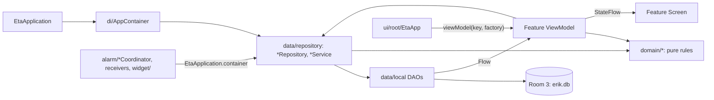

# Repository Guidelines

Orientation for AI coding assistants in this fork of Eta. Canonical sources beat
this file: code and build config for runtime behavior, `Eta_doc/*.md` for
requirements (German), `.claude/rules/*.md` for subject notes (`step-*`/`steps-*`
are historical), [`docs/`](docs/README.md) for workflow. Link to them instead of
copying ([`docs/workflow.md`](docs/workflow.md)). If the upstream owner's
`CLAUDE.md` is present, this file wins; its session routine (APK into `dist/`,
committing to `main`, Windows paths) does not apply here.

Code paths are relative to `app/src/main/java/com/example/eta/` unless they start
with a top-level directory.

## Project Overview

- Android productivity app: smart to-do lists (cards move through five `Stage`s),
  day and week planner over a standing schedule, reward-point ledger and rewards
  (Belohn-o-mat), self-contracts, reminders and alarms, read-only Google Calendar
  import, first-run setup, sandboxed tutorial.
- One Gradle module `:app`: Kotlin, Jetpack Compose **Foundation** (no Material),
  Room 3, `kotlinx-datetime`. No DI framework, navigation library or WorkManager.
- UI text is German, hard-coded in Kotlin (`strings.xml` holds only the app name
  and widget labels). Code, identifiers, comments and commits are English.

## Architecture & Data Flow



- **Startup:** `EtaApplication.onCreate` builds the one `AppContainer`, creates
  notification channels and re-arms all alarms. `MainActivity` (`singleTask`)
  renders `EtaTheme { EtaApp(…) }`; `RootViewModel` runs
  `ScheduleMaintenance.topUp()` and the weekly inflation.
- **DI (manual):** `di/AppContainer.kt` holds every repository, service and
  coordinator as an eager `val`; declare dependencies above their users and pass
  `clock = clock`. ViewModels get it through factories in `ui/root/ViewModelFactories.kt`;
  activities, receivers and the widget use
  `(applicationContext as EtaApplication).container`.
- **Sandbox:** the tutorial runs a second
  `AppContainer(context, sandbox = true, clock = clock)` with an in-memory DB and
  alarms off (`ui/tutorial/TutorialViewModel.kt`). `Clock.System`, the DB file and
  other globals escape it; `BackupService` always targets the real `erik.db`.
- **Layers:** `domain/` is pure functions taking `now`/`today`/`timeZone` (no
  coroutines, `Flow` or `android.*`). `data/repository/` orchestrates DAOs and
  domain functions: `observe*` returns `Flow`, writes and one-shot reads are
  `suspend`. The split is pragmatic: entities in `domain/model/` carry Room
  annotations (no mappers), `domain/reward/Yield.kt` uses
  `data.local.BlockWithItem`, `alarm/` uses `ui.format`/`ui.theme`, and ViewModels
  call domain functions directly.
- **Navigation (no library):** `ui/root/EtaApp.kt` switches on `RootDestination`
  (`Loading`/`Setup`/`Dashboard`), `AppFlow` (full-screen flows over the tab bar)
  and `EtaTab` (seven tabs; Contracts, Growth, Rewards gated by `LocalFeatures`).
  `TAB_SAVER`/`FLOW_SAVER` store enum names: renaming an entry drops saved state.
- **Day flow:** planning notifications put `EXTRA_OPEN_PHASE`/`EXTRA_DEFER_PHASE`
  on the launch intent, consumed once by `MainActivity`. DAILY runs Reevaluation →
  Concretize → Calendar → Planner; WEEKLY opens WeekPlanner.
  `ReevaluationService.settle` harvests points and settles contracts, growth and
  rewards; `DayClosingService` handles discards and make-up ToDos.
- **Alarms:** `AlarmManager` only, no Services. Per kind (Planning, TaskStart,
  Wake, Reminder): a `*Coordinator` decides what to arm, `<Kind>AlarmScheduler`
  arms it (`setAlarmClock` for planning/wake, `setExactAndAllowWhileIdle`
  otherwise, `setWindow` when exact alarms are denied; `alarm/AlarmReadiness.kt`),
  `<Kind>AlarmReceiver` handles RING in `goAsync()` with `finish()` in `finally`.
  Re-armed on app start, boot (`BootCompletedReceiver` in
  `PlanningAlarmReceiver.kt`), after each ring and each edit; no time-zone-change
  receiver.
- **Calendar:** read-only Google REST (`calendar.readonly` via Play Services
  `AuthorizationClient`, hand-written `HttpURLConnection` on `Dispatchers.IO`), no
  `READ_CALENDAR`. Sync is idempotent via `CalendarEvent.idOf(calendarId, eventId)`.
- **Backup:** `data/backup/BackupService.kt` zips `erik.db`, `-wal`, `-shm` via the
  Storage Access Framework; restore needs an app restart. SharedPreferences
  (design, tutorial, folds, sound) are not included.
- **Example path:** `PlannedBlockDao.observeForDateWithItems` →
  `PlanRepository.observeDay` → `DayPlannerViewModel` (`combine` + `stateIn`) →
  `DayPlannerScreen`. Write: `QuickAddViewModel.quickAdd` →
  `ItemRepository.addQuickTodo` → `ItemDao.upsert`.

### Invariants

Each guards against a past bug or an owner decision; background in
[`.claude/rules/database.md`](.claude/rules/database.md) and
[`docs/architecture.md`](docs/architecture.md).

- **Identity:** `applicationId = "com.example.erik_iteration_2"` (namespace
  `com.example.eta`), `EtaDatabase.NAME = "erik.db"`. A new id installs a second,
  empty app; the DB name is the entry inside every backup zip.
- **Definition vs. occurrence:** `Item` defines a card and never says *when*.
  `PlannedBlock` is one occurrence on one date and is what gets checked off (open,
  `completedAt`, `discardedAt`). `DayPlan` holds per-date confirmation and
  settlement state.
- **One block per `(itemId, date)`:** unique index plus
  `PlannedBlockDao.insertMissing` (`IGNORE`). Never upsert materialized blocks.
- **Materialization** only via `ScheduleMaintenance.topUp()`/`topUpUntil(date)`
  (growth: `relayOccurrences`, `relayDynamicGrowth`). `expandRecurring` re-creates
  a deleted future block; suppress an occurrence with `discardedAt`, a vacation or
  `repeatUntil` instead.
- **Items:** null `targetDate` means available now (`Item.isAvailableOn`). Create
  via `Item.newTodo`/`newQuickTodo`/`newDeadline`/`newRecurring`/`newSpend`/
  `newMakeUpTodo`; rename via `Item.renamed` (keeps `normalizedName`, the
  Sperrliste key); set category, priority and duration via `Item.concretized`.
- **Collection:** a dropped ToDo returns to `COLLECTION` and keeps
  `enteredCollectionAt`, so the Sperrliste cannot be dodged.
- **Points:** the balance is the sum of `PointsTransaction` rows, never stored.
  Amounts come only from `yieldOf` (`domain/reward/Yield.kt`); only
  `ReevaluationService` writes `HARVEST` rows and fills rewards, so checking off
  credits nothing before the evening settlement. Signs: `formatSignedPoints` only.
- **Roles:** identify a kind of block by `Item.role` (`ItemRole`), never by id;
  the `setup:` id prefix marks setup-generated definitions.
- **Lists:** the Erfolgsliste is completed blocks minus standing (`RECURRING`)
  tasks, not `Stage.DONE`; "Liste für Morgen" is not a `Stage`.

## Key Directories

| Path | Purpose |
|---|---|
| `domain/<topic>/` | Pure rule functions (planning, recurrence, reward, reevaluation, contract, …) |
| `domain/model/` | Room entities that are also the domain models; enums (`Stage`, `ItemRole`, `Category`, …) |
| `data/local/` | `EtaDatabase` (version, migrations, `ETA_DATABASE_MIGRATIONS`), DAOs, `Converters`, `ResetDao` |
| `data/repository/` | `*Repository` (flows, CRUD), `*Service` (multi-step use cases), `ScheduleMaintenance` |
| `alarm/` | Coordinators, schedulers, receivers, notifications, sound, speech, wake screen |
| `ui/root/` | `EtaApp.kt` (navigation), `ViewModelFactories.kt` (ViewModel factories), `RootViewModel` |
| `ui/components/`, `ui/theme/`, `ui/format/` | `Eta*` Foundation design system, designs, German formatters |
| `widget/` | Quick-Add `RemoteViews` widget and its translucent `QuickAddActivity` |
| `app/schemas/com.example.eta.data.local.EtaDatabase/` | Committed Room schema JSON per version |
| `.claude/rules/` | Subject notes (current topic notes, historical `step-*`/`steps-*`) |
| `docs/`, `scripts/`, `zensical.toml` | Docs-as-code guides, checker, site build |
| `sounds/` | Source copies of `app/src/main/res/raw/*.mp3`; keep both identical |

Before changing code, look up its path in
[`docs/documentation-map.json`](docs/documentation-map.json) and read the listed
notes. Unmapped: tutorial → `step-38-tutorial.md`, `domain/staging` → `lists.md`,
`domain/streak` → `streak-reevaluation.md`. The map's `domain/weekplanning/**` and
`domain/pomodoro/**` globs match nothing; that code is in `domain/planning/`
(`week-planning.md`, `step-18-standing-schedule.md`).

## Development Commands

`gradlew` is tracked as mode `100644`, so `./gradlew` fails with "Permission
denied": run it through `bash` (Windows: `gradlew.bat`); don't commit a mode change.

```bash
bash ./gradlew --console=plain testDebugUnitTest lint assembleDebug   # PR CI gate
bash ./gradlew testDebugUnitTest                  # XML: app/build/test-results/testDebugUnitTest/
bash ./gradlew testDebugUnitTest --tests "*.YieldTest"
bash ./gradlew testDebugUnitTest --tests "*.YieldTest.Fokus yields one point per hour"
bash ./gradlew testDebugUnitTest --tests "*.EtaDatabaseMigrationTest"
bash ./gradlew lint                               # app/build/reports/lint-results-debug.*
bash ./gradlew installDebug                       # connected device
bash ./gradlew assembleRelease                    # unsigned unless the signing env vars are set
adb shell am start -n com.example.erik_iteration_2/com.example.eta.MainActivity

python3 scripts/documentation.py check                      # docs metadata, links, map, Gradle/Room projection
python3 scripts/documentation.py check --base origin/main   # docs to review for committed changes
python3 -m unittest discover -s scripts/tests -v
python3 -m venv .venv-docs && .venv-docs/bin/python -m pip install -r requirements-docs.txt
.venv-docs/bin/python scripts/documentation.py build        # or: serve --port 8000
```

No git hooks, formatter task, lint baseline or release/copy script exist.

## Code Conventions & Common Patterns

- **Style:** `kotlin.code.style=official`; no ktlint, detekt, spotless or
  `.editorconfig`, so match surrounding code. Comments explain *why*. Helpers
  shared across files are `internal`.
- **Naming:** UI `*Screen`, `*ViewModel`, `*Dialog(s)`, private `*Box`/`*Card`/
  `*Step`/`*Section`/`*Row`; data `*Dao`, `*Repository`, `*Service`; alarms
  `*Coordinator`, `<Kind>AlarmContract`/`Scheduler`/`Receiver`,
  `*Notifications.kt`; domain uses top-level verb/noun functions and extensions
  (`settleDay`, `expandRecurring`, `yieldOf`), never `*UseCase`/`*Calculator`
  classes; sealed outcomes `*Result`/`*Outcome` (`AddItemResult`, `SyncOutcome`);
  migrations `MIGRATION_<n>_<n+1>`.
- **ViewModels:** constructor takes services plus `clock: Clock = Clock.System`
  and usually `timeZone: TimeZone = TimeZone.currentSystemDefault()`. Factories
  (`viewModelFactory { initializer { … container.x … } }`) sit in
  `ui/root/ViewModelFactories.kt`, except `quickAddViewModelFactory` and
  `tutorialViewModelFactory`. Obtain with
  `viewModel(key = "<feature>-$dateKey", factory = …)`; the date key
  (`rememberDateKey()`) recreates the ViewModel at midnight.
- **State:** `combine`/`map` +
  `.stateIn(viewModelScope, SharingStarted.WhileSubscribed(5_000), initial)` or a
  private `MutableStateFlow` + `asStateFlow()`; screens use
  `collectAsStateWithLifecycle()`; dialog state in `remember`/`rememberSaveable`.
  One-shot events are nullable state plus a `dismiss…()` call consumed in
  `LaunchedEffect` (no `Channel`/`SharedFlow`). User settings live in Room
  (`UserSetup`); device/UI preferences in SharedPreferences (`DesignStore`,
  `TutorialStore`, `Fold`, `EtaSound`).
- **Time:** `kotlin.time.Clock`/`Instant` (global
  `-opt-in=kotlin.time.ExperimentalTime`), never `kotlinx.datetime.Instant`; plus
  `kotlinx.datetime` `LocalDate`/`LocalTime`/`TimeZone`. No `Clock.System` in new
  code: the tutorial runs on a simulated clock (`TutorialClock`, `LocalEtaClock`).
  `Converters.kt` stores `Instant` as epoch millis, `LocalDate` as ISO,
  `LocalTime` as second-of-day, `Duration` as seconds, enums by name.
- **Coroutines:** writes via `viewModelScope.launch`; network in
  `withContext(Dispatchers.IO)`; app and receiver jobs in
  `CoroutineScope(SupervisorJob() + Dispatchers.Default)`; coroutines arrive
  transitively. No `withTransaction` exists: multi-write paths are not atomic, so
  keep writes idempotent (unique indexes, `IGNORE`).
- **Errors:** nullable returns for expected absence; sealed outcomes with German
  messages for anything user-visible; `runCatching` at Android/IO boundaries;
  domain throws only via `require`/`error` in setup validation and decoders. No
  logging framework.
- **Entities:** UUID string ids and `createdAt`/`updatedAt` on mutable rows
  (`DayPlan` is keyed by date, `PointsTransaction` is append-only). Computed
  properties need `@get:Ignore`. Room 3 (`androidx.room3`): converters use
  `@ColumnTypeConverter(s)`; `@Relation` columns are arrays.
- **Compose:** build from `ui/components` (`EtaScreen` replaces `Scaffold`; new
  dialogs use `EtaDialog`/`ConfirmDialog`; `EtaText`, `EtaButton`,
  `EtaTextField`, pickers) and `EtaTheme.colors/typography/shapes/spacing`.
  Clickables pass `indication = null` and draw their own pressed state; no
  `@Preview`s. A new `AppDesign` needs `colorsOf`/`shapesOf` branches and a widget
  layout set (`QuickAddWidgetProvider.layoutOf`).
- **Notifications:** post only via `postNotification` (`alarm/EtaSound.kt`, checks
  `POST_NOTIFICATIONS`). Check existing request codes (`*AlarmContract`) and
  notification ids (`*Notifications.kt`) in `alarm/` before adding one;
  `PendingIntent`s use `FLAG_IMMUTABLE`.

### Changing the Room schema

1. Bump `version` in `@Database` (`data/local/EtaDatabase.kt`); add
   `val MIGRATION_<n>_<n+1>` there (no auto-migrations, no destructive fallback).
2. Append it to `ETA_DATABASE_MIGRATIONS` (used by `AppContainer` and the test).
3. New table: list it in `@Database(entities = …)`, add a DAO accessor and a delete
   in `ResetDao.clearEverything()`.
4. Build; KSP writes `app/schemas/…/<n+1>.json`. Commit it; diff your SQL against it.
5. Run `EtaDatabaseMigrationTest`; extend the migration table in
   `.claude/rules/database.md`.
6. New enum values need no migration (stored by name); renames do.

Never "repair" a migration by deleting or recreating a user database.

### Traps

- AGP 9 has built-in Kotlin (no `kotlin-android` plugin); keep
  `android.disallowKotlinSourceSets=false`, KSP needs it.
- Core library desugaring is mandatory: `kotlinx-datetime` needs `java.time` on
  `minSdk` 24.
- Material/Material 3 are not on the compile classpath; their imports fail
  (`material3` reaches only the debug *runtime* classpath via `ui-tooling`).
- `pointerInput` lambdas must not capture composition values; read
  `rememberUpdatedState`/`State` and ids.
- Lists of stateful cards need `key(item.id)`, or state such as an armed
  "Wirklich?" moves to the neighbour.
- In `semantics { }`, a parameter named `contentDescription` compiles and throws
  at runtime; call it `label`.
- Callbacks take a plain `(T) -> R`; a receiver lambda `T.() -> R` breaks
  `onChange { it.copy(…) }`.
- `launchIntent` (`alarm/PlanningAlarm.kt`) names `"com.example.eta.MainActivity"`
  as a string; moving `MainActivity` breaks notification taps.

## Important Files

- **Manifest:** `app/src/main/AndroidManifest.xml` (activities incl.
  `alarm.WakeAlarmActivity` over the lock screen, widget provider, four alarm
  receivers, `BootCompletedReceiver`; exact-alarm, full-screen-intent, boot,
  notification and internet permissions).
- **Wiring:** `EtaApplication.kt`, `MainActivity.kt`, `di/AppContainer.kt`,
  `ui/root/EtaApp.kt`, `ui/root/RootViewModel.kt`.
- **Data and services:** `data/local/EtaDatabase.kt`, `Converters.kt`,
  `ResetDao.kt`, `PlannedBlockDao.kt`, `PointsDao.kt`;
  `data/repository/ScheduleMaintenance.kt`, `PlanRepository.kt`,
  `ItemRepository.kt`, `ReevaluationService.kt`, `DayClosingService.kt`.
- **Domain:** `domain/model/Item.kt`, `PlannedBlock.kt`, `ItemType.kt`
  (`ItemRole`), `Category.kt` (yield multipliers),
  `domain/recurrence/RecurrenceExpansion.kt`, `domain/reward/Yield.kt`,
  `domain/reevaluation/DailySettlement.kt`.
- **Alarms:** `alarm/EtaSound.kt` (channels, `postNotification`, Do Not Disturb),
  `alarm/AlarmReadiness.kt`, `alarm/PlanningAlarm.kt`.
- **Build, CI, docs:** `gradle/libs.versions.toml`, `app/build.gradle.kts`,
  `gradle.properties`, `settings.gradle.kts`, `.github/workflows/android.yml`,
  `.github/workflows/documentation.yml`, `.github/pull_request_template.md`,
  `docs/documentation-map.json`, `docs/development.md`, `docs/ci-cd.md`.

## Runtime/Tooling Preferences

- **JDK:** JDK 25 runs the Gradle daemon (`gradle/gradle-daemon-jvm.properties`;
  CI uses Temurin 25); bytecode targets Java 11.
- **Android SDK:** from `ANDROID_HOME` or the untracked `local.properties`
  (`sdk.dir`). SDK levels in `app/build.gradle.kts` (compile/target 37, min 24);
  CI installs `platforms;android-37.0` and `build-tools;36.0.0`.
- **Versions:** read `gradle/libs.versions.toml` (Gradle:
  `gradle/wrapper/gradle-wrapper.properties`) rather than trusting snapshots. KSP
  only, no kapt; configuration cache on.
- **Dependencies:** add `[versions]` (camelCase) and `[libraries]` (kebab-case,
  used as `libs.a.b.c`) entries, then use them in `app/build.gradle.kts`.
  Repositories are fixed in `settings.gradle.kts` (`FAIL_ON_PROJECT_REPOS`).
- **Owner decisions** (ask the owner before changing): Compose Foundation only; no
  DI framework or extra annotation processor; no entity/model mappers; local Room
  only, sync-ready (UUID keys, `updatedAt`); Calendar read-only; the Eta design is
  the default and follows the system's dark mode.
- **Release:** R8 is off (`optimization { enable = false }`;
  `app/src/main/keepRules/rules.keep` is inert). Signing comes only from
  `ANDROID_KEYSTORE_PATH`, `ANDROID_KEYSTORE_PASSWORD`, `ANDROID_KEY_ALIAS`,
  `ANDROID_KEY_PASSWORD` (all or none), the version from
  `ETA_RELEASE_VERSION=MAJOR.MINOR.PATCH` ([`docs/ci-cd.md`](docs/ci-cd.md)).
  Never commit, print or log secrets.
- **Docs tooling:** Python 3.11+ (`check` is stdlib-only); Zensical pinned in
  `requirements-docs.txt`, installed into `.venv-docs/`. Never edit generated
  `build/documentation/`. Tracked docs must not contain local machine paths or
  private data.

### Git and fork workflow

- `origin` = this fork (`Roden69/ETA`), push here; `upstream` = the owner's
  `Erbsenherr/Eta_productivity_application`, fetch only.
- One topic branch per subject (`feat/`, `chore/`, `docs/`, `test/`, `ci/`),
  integrated through `dev/*` branches or PRs; never commit directly on `main`.
  Subjects are imperative sentence case (`Test every Room migration against
  exported schemas`); docs-only commits use `docs: …`.
- PRs cover one subject, ship the matching `.claude/rules` note and fill
  [`.github/pull_request_template.md`](.github/pull_request_template.md) (German):
  documentation review per mapped topic and only verification actually run.
- **Schema divergence:** the fork and upstream previously shipped different
  version-28 layouts. The common schema is now version 33, with a direct upgrade
  retaining fork night corrections and upstream additions. Preserve the historical
  schema files and shared migration list; see
  [the canonical migration notes](.claude/rules/database.md).
- Never check out commits older than `a693750`: they track `local.properties` and
  `dist/`, overwriting the ignored local copies and deleting them on the way back.
- APKs update an install only when signed with the same key; builds from this fork
  cannot update the owner's phone. Never uninstall to bypass a signature mismatch:
  that wipes `erik.db`. Calendar sign-in needs an OAuth client for the signing
  key's SHA-1 ([`.claude/rules/google-calendar.md`](.claude/rules/google-calendar.md)).
- `patchnotes/` and `update.txt` (informal backlog) are the owner's; add patch
  notes only when asked.

## Testing & QA

- **Stack:** JUnit 4 on the JVM (`app/src/test/java/com/example/eta/`). Robolectric
  runs `EtaDatabaseMigrationTest` (`@Config(sdk = [35])`, `room3-testing`'s
  `MigrationTestHelper`), the repository tests and the scenario harness in
  `scenario/` ([`docs/testing.md`](docs/testing.md)). `kotlinx-coroutines-test`
  supplies `Dispatchers.setMain` for the harness only. No mocking library, Turbine
  or Truth; the only fake is a private `FixedClock` in `TutorialTest`.
- **Coverage:** pure `domain/` rules plus `ui/` design and formatting helpers.
  Repositories, DAOs beyond migrations, alarms, calendar, backup, widget,
  screens are untested, ViewModels are covered only by `scenario/`: put new logic in a pure `domain/` function
  and test it there. No coverage tool; lint has no baseline, keep it error-free.
- **House style:** `<Subject>Test` with backticked sentence names; all domain tests
  in package `com.example.eta.domain`; private per-class builders over real
  factories (`Item.newTodo`, `UserSetup.draft(now)`); fixed
  `Instant.parse(…)`/`LocalDate(…)` with an explicit `TimeZone`; doubles compared
  with `0.0001` tolerance.

  ```kotlin
  @Test
  fun `Fokus yields one point per hour`() {
      val item = todo(Category.FOKUS)
      assertEquals(2.0, yieldOf(item, block(item.id, 2.hours)), 0.0001)
  }
  ```

- **Migration suite:** requires contiguous schema files covered by
  `ETA_DATABASE_MIGRATIONS`, validates every step against the exported JSON and
  carries one version-1 `items` row to the latest version. Schemas are staged in a
  temporary test-only APK, never shipped.
- **Instrumented:** `app/src/androidTest` holds only the template
  `ExampleInstrumentedTest`; `connectedDebugAndroidTest` needs a device, not in CI.
- **CI:** `.github/workflows/android.yml` runs `testDebugUnitTest lint
  assembleDebug` on PRs and pushes to `main` (uploads debug APK and reports);
  `v*.*.*` tags build a signed `assembleRelease` and publish a GitHub release.
  `.github/workflows/documentation.yml` runs `check`, the unittest suite,
  `check --base` on PRs, and `build`.
- **Manual:** changes to screens, navigation, permissions, alarms, calendar or
  system integration need a check on a physical device
  ([`docs/development.md`](docs/development.md)). Report only checks you ran;
  tests, compilation and lint do not prove UI behavior.
