<p align="center">
  
</p>

<h1 align="center">ETA</h1>

<p align="center">
  <b>Wichtige Aufgaben fallen uns oft im falschen Moment ein.<br>
  Eta fängt sie auf und holt sie im richtigen Moment wieder hervor.</b>
</p>

<p align="center">
  <a href="https://github.com/Roden69/ETA/actions/workflows/android.yml"></a>
  <a href="https://github.com/Roden69/ETA/actions/workflows/documentation.yml"></a>
</p>

ETA ist eine Android-App für Menschen, die ihren Alltag selbst in die Hand nehmen wollen: Aufgabenlisten, Tages- und Wochenplanung über einem festen Wochenplan, Routinen, Belohnungspunkte und Selbstverträge in einem geschlossenen Kreislauf. Alles bleibt auf dem Gerät. Die Oberfläche ist deutsch.

Dieses Repository ist ein Fork von [Erbsenherr/Eta_productivity_application](https://github.com/Erbsenherr/Eta_productivity_application). Was der Fork dazugibt, steht [weiter unten](#dieser-fork); was sich pro Version ändert, in den [Release Notes](CHANGELOG.md).

## So sieht es aus

<table>
  <tr>
    <td align="center" valign="top">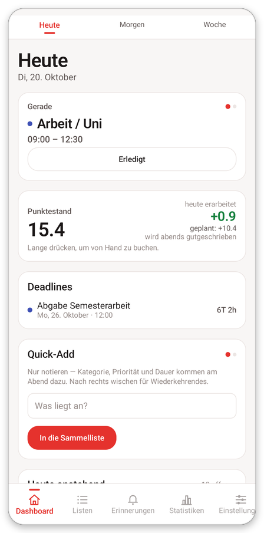<br><sub><b>Heute</b><br>Laufende Aufgabe, Punkte, Deadlines</sub></td>
    <td align="center" valign="top">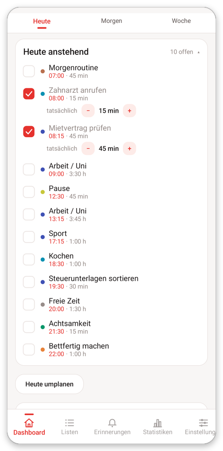<br><sub><b>Heute anstehend</b><br>Der ganze Tag, farbig nach Art</sub></td>
    <td align="center" valign="top">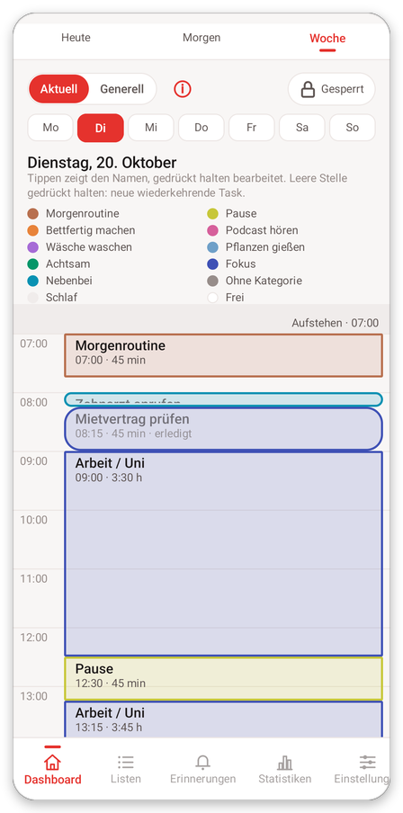<br><sub><b>Woche</b><br>Zeitraster mit Legende</sub></td>
    <td align="center" valign="top">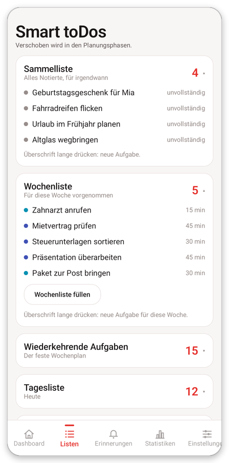<br><sub><b>Listen</b><br>Von der Notiz zur Wochenaufgabe</sub></td>
  </tr>
  <tr>
    <td align="center" valign="top">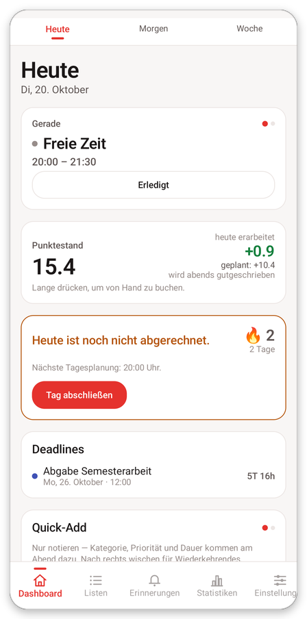<br><sub><b>Abends</b><br>Tag abschließen, Streak</sub></td>
    <td align="center" valign="top">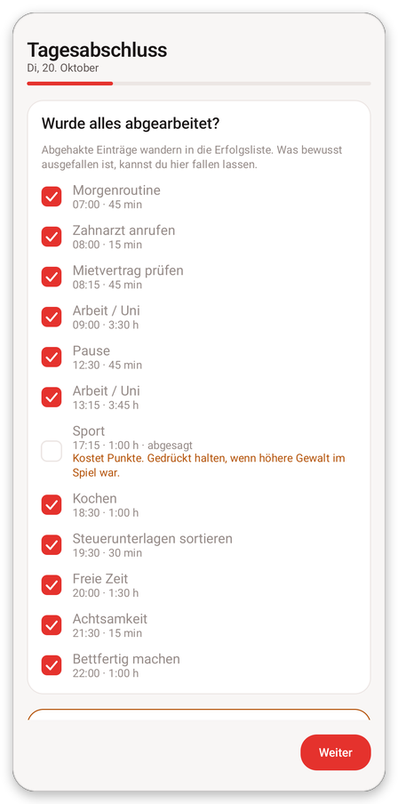<br><sub><b>Tagesabschluss</b><br>Abhaken, absagen, begründen</sub></td>
    <td align="center" valign="top">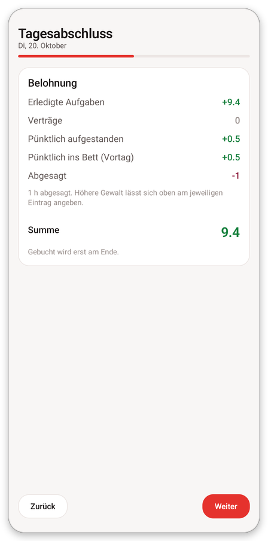<br><sub><b>Abrechnung</b><br>Was der Tag an Punkten bringt</sub></td>
    <td align="center" valign="top">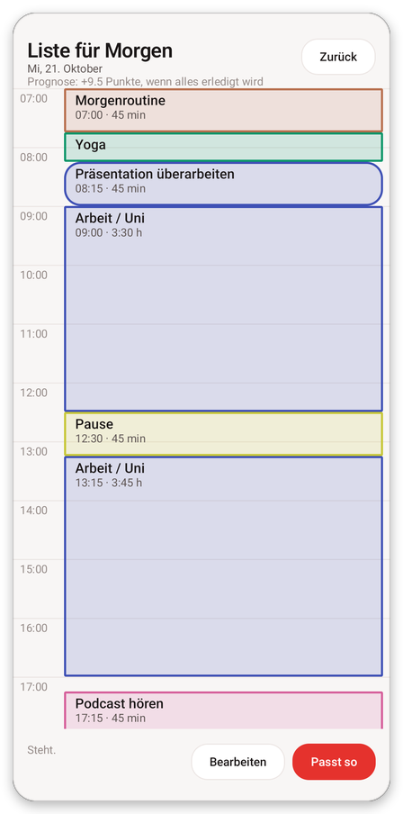<br><sub><b>Liste für Morgen</b><br>Planung mit Punkteprognose</sub></td>
  </tr>
  <tr>
    <td align="center" valign="top">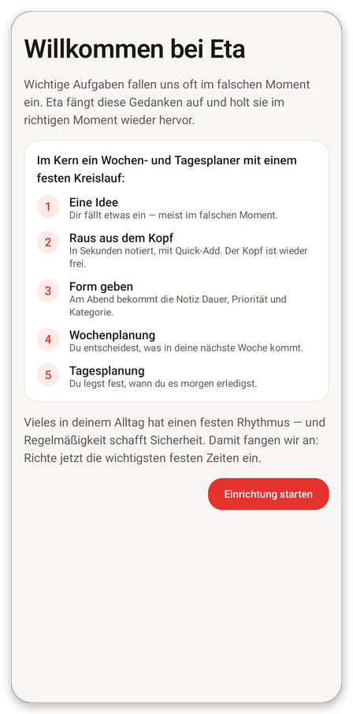<br><sub><b>Einstieg</b><br>Der Kreislauf in fünf Schritten</sub></td>
    <td align="center" valign="top">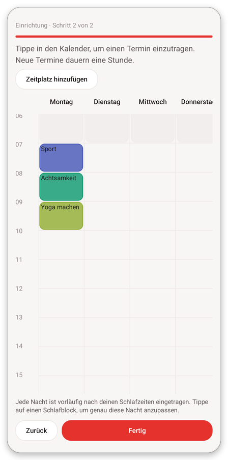<br><sub><b>Einrichtung</b><br>Feste Zeiten im Wochenraster</sub></td>
    <td align="center" valign="top">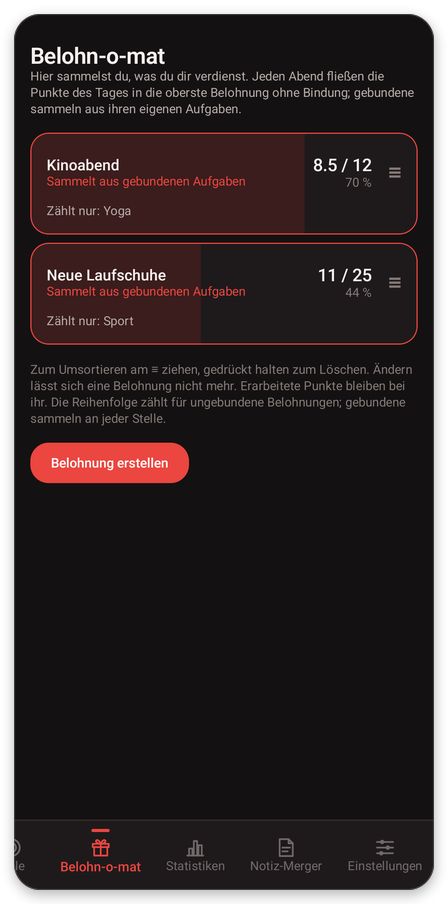<br><sub><b>Belohn-o-mat</b><br>Punkte füllen die Belohnung</sub></td>
    <td align="center" valign="top">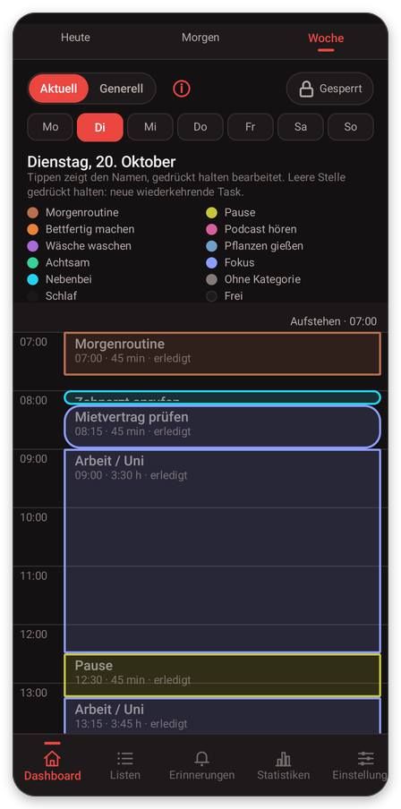<br><sub><b>Dunkles Design</b><br>Folgt dem System</sub></td>
  </tr>
</table>

<sub>Die Bilder stammen aus einem Android-15-Emulator mit erfundenen Beispieldaten (Dienstag, 20. Oktober). Sie zeigen die Variante *Eta Fork*.</sub>

## Was Eta kann

**Der Kreislauf.** Eine Idee kommt, du notierst sie in Sekunden (Quick-Add, auch als Widget), am Abend gibst du ihr Kategorie, Priorität und Dauer, in der Wochenplanung entscheidest du, was in die Woche kommt, und in der Tagesplanung, wann du es erledigst. Karten wandern dabei durch fünf Stufen: Sammelliste, Sperrliste, Wochenliste, Tagesliste, erledigt.

- **Festes Gerüst:** Schlaf, Morgenroutine, Arbeit, Essen, Sport, Achtsamkeit und eigene Routinen stehen im Wochenplan. Die Einrichtung fragt nur, was du brauchst; weitere Funktionen schlägt Eta später vor.
- **Tag und Woche:** Heute, Morgen und Woche auf einer Seite, mit laufender Aufgabe, Überschneidungswarnungen, Pausenhinweis und Wochenplanung über das gewählte Planfenster.
- **Tagesabschluss:** Abhaken, Absagen mit höherer Gewalt, kurzes Nachdenken, wiederkehrende Aufgaben ausrangieren. Verpasste Abende lassen sich nachholen.
- **Punkte und Belohnungen:** Das Punktekonto ergibt sich aus dem, was du wirklich erledigt hast. Der Belohn-o-mat sammelt für selbstgewählte Belohnungen, optional an einzelne Aufgaben gebunden.
- **Selbstverträge, Ziele, Notizen:** Verträge mit dir selbst, Timer-Tasks und Ziele, Notiz-Merger. Alles lässt sich in den Einstellungen abschalten.
- **Erinnerungen und Wecker:** Eigene Erinnerungen, Aufgaben-Töne, Planungsalarme und ein Weckruf; wahlweise legt Eta die Aufstehzeiten als Wecker in deiner Uhr-App an. Bei stummem Handy vibriert Eta statt zu klingeln; das Verhalten bei „Nicht stören“ stellst du ein.
- **Google Kalender (nur lesend):** Termine erscheinen im Wochenraster, werden stündlich abgeglichen und lassen sich als Zeitblocker oder wiederkehrende Aufgabe übernehmen. Geschrieben wird nie.
- **Statistik und Streak:** Pünktlichkeit, eingeplante Zeit, Zeit je Kategorie.
- **Üben ohne Risiko:** Ein geführtes Tutorial läuft auf Übungsdaten in einer eigenen Datenbank und berührt deine Daten nicht.
- **Dein Aussehen:** Zwei Designs, hell und dunkel oder wie das Handy, eigene Akzentfarbe.
- **Deine Daten:** Alles liegt lokal in einer Room-Datenbank. Sichern und Wiederherstellen unter *Einstellungen → Deine Daten*.

## Dieser Fork

Der Fork [Roden69/ETA](https://github.com/Roden69/ETA) ergänzt die Originalapp um:

- **Bearbeitete Issues:** 47 Verbesserungen und Fehlerbehebungen rund um Einrichtung, Kalender, Wochenansicht, Tagesablauf, Töne und Texte. Sie sind in den [Release Notes](CHANGELOG.md) nach Bereichen aufgelistet.
- **Respekt vor dem Handy:** Stumm- und Vibrationsmodus, „Nicht stören“ und Schlummerdauer folgen klaren Regeln.
- **Parallel testbar:** Die Variante **Eta Fork** (`com.example.erik_iteration_2.fork`) läuft neben der Originalinstallation, mit eigenen Daten.
- **Fertige APKs aus der CI:** Jeder Lauf auf `main` stellt Debug- und Fork-APK bereit, Versions-Tags veröffentlichen eine signierte Release-APK.
- **Prüfbare Migrationen und Abläufe:** Jeder Schemaschritt der Room-Datenbank (aktuell Version 36) wird gegen die exportierten Schemas getestet. Regel-, mehrtägige Szenario- und Oberflächentests laufen im Pull Request, Gerätetests zusätzlich nachts.
- **Dokumentation als Code:** Anforderungen, Fachnotizen und Architektur sind versioniert, geprüft und als durchsuchbare Website baubar.

Änderungen laufen als Pull Requests über Themenzweige und `dev/*`-Zweige; `main` ist der geprüfte Stand.

## Installieren

Dieser Fork verteilt Eta als APK, nicht über den Play Store.

| Quelle | Wann | Hinweis |
| --- | --- | --- |
| [Releases](https://github.com/Roden69/ETA/releases) | Für Versionen mit Tag | Signierte Release-APK `Eta-vX.Y.Z.apk` |
| [Actions](https://github.com/Roden69/ETA/actions) → Lauf **Android CI/CD** auf `main` → Artifacts | Für den neuesten Stand | `eta-debug-apk` (Debug) oder `eta-fork-apk` (Eta Fork), jeweils als ZIP mit einer APK |
| Selbst bauen | Für eigene Änderungen | Siehe unten |

Auf dem Gerät die Installation aus unbekannten Quellen für die App erlauben, mit der du die APK öffnest.

**Update oder zweite App?** Eine APK aktualisiert nur eine Installation, die mit demselben Schlüssel signiert ist. Bei einer Signaturabweichung **nicht deinstallieren**: Das löscht die Datenbank. Installiere dann die Variante *Eta Fork* daneben.

**Vor einem Update** unter *Einstellungen → Deine Daten* **Sichern** drücken. Die Datenbank wird beim ersten Start auf die neue Version migriert; zurück zu einer älteren App führt danach kein Weg.

Für die Google-Kalender-Anmeldung braucht jeder Signaturschlüssel einen eigenen OAuth-Client, siehe [Kalender-Anmeldung einrichten](docs/calendar-oauth.md).

## Selbst bauen

Voraussetzungen: das Android SDK (über `ANDROID_HOME` oder eine lokale `local.properties` mit `sdk.dir`) und JDK 25 für den Gradle-Daemon. Unter Linux den nicht ausführbar eingecheckten Wrapper durch Bash starten:

```bash
bash ./gradlew --console=plain testDebugUnitTest lint assembleDebug   # Prüfung wie in der CI
bash ./gradlew installDebug                                           # auf ein verbundenes Gerät
bash ./gradlew assembleFork                                           # „Eta Fork“, neben dem Original installierbar
```

APKs landen unter `app/build/outputs/apk/<variante>/`. Ablauf, Gerätekontrolle und Signaturgrenzen: [Entwicklung und Prüfung](docs/development.md).

## Technik

| | |
| --- | --- |
| Sprache, UI | Kotlin, Jetpack Compose **Foundation** (ohne Material), eigenes Design-System `Eta*` |
| Daten | Room 3, `kotlinx-datetime`, lokale Datenbank `erik.db` (Schema 36) |
| Struktur | Ein Gradle-Modul `:app`, manuelle Abhängigkeiten (`AppContainer`), keine Navigationsbibliothek, kein WorkManager |
| Alarme | `AlarmManager` mit je einem Coordinator, Scheduler und Receiver pro Art |
| Android | `minSdk` 24, `targetSdk` 37 |

Details und Invarianten: [Architektur](docs/architecture.md).

## Dokumentation

**[Einstieg für Menschen und KI-Agenten: docs/README.md](docs/README.md)**

- [Release Notes](CHANGELOG.md): was sich pro Version geändert hat
- [Architektur und Zuständigkeiten](docs/architecture.md)
- [Entwicklung, Builds und Prüfung](docs/development.md)
- [Android-CI/CD und Veröffentlichung](docs/ci-cd.md)
- [Kalender-Anmeldung (OAuth)](docs/calendar-oauth.md)
- [Dokumentationspflege und KI-Workflow](docs/workflow.md)
- [Produktspezifikationen](Eta_doc/Konzept.md)
- [Themenzuordnung zu kanonischen Quellen](docs/documentation-map.json)

Spezifikationen unter `Eta_doc/` und Fachnotizen unter `.claude/rules/` bleiben die Quellen. Die durchsuchbare Website wird daraus erzeugt (Python 3.11 oder neuer):

```bash
python3 -m venv .venv-docs
.venv-docs/bin/python -m pip install -r requirements-docs.txt
python3 scripts/documentation.py check
.venv-docs/bin/python scripts/documentation.py serve --port 8000    # http://127.0.0.1:8000/
```

Ein statischer Build entsteht mit `.venv-docs/bin/python scripts/documentation.py build` unter `build/documentation/site/`. Eine öffentliche Veröffentlichung ist nicht eingerichtet.

## Herkunft und Lizenz

Eta stammt von [Erbsenherr](https://github.com/Erbsenherr/Eta_productivity_application). Für dieses Repository ist **keine Lizenz** erteilt, siehe [`LICENSE`](LICENSE): Ohne ausdrückliche Erlaubnis der Rechteinhaber darfst du den Code weder weiterverwenden noch verbreiten.
